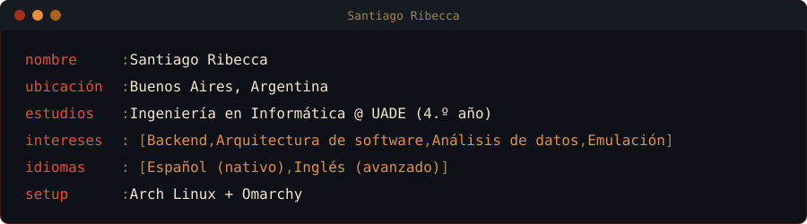

<!-- BANNER ANIMADO -->

<!-- TEXTO ANIMADO -->

 

##  Sobre mí

##  Tecnologías

| # | Categoría | Íconos |
|---|---|---|
|  | **Lenguajes** |  |
|  | **Backend** |  |
|  | **Frontend** |  |
|  | **Bases de datos** |  |
|  | **DevOps y herramientas** |  |

##  Proyectos

| Proyecto | Qué es | Stack |
|---|---|---|
|  **Emulador de NES** | Emulación ciclo a ciclo del CPU 6502 validada contra nestest, PPU, APU y 5 mappers (~85% del catálogo), con save states y debugger | Go · SDL2 |
|  **Ecopedia** | Plataforma de reserva y tarificación de estaciones de carga para autos eléctricos, en servicios con JWT compartido, mensajería JMS y SOAP | Java 21 · Spring Boot · ActiveMQ · PostgreSQL · React 19 |
|  **Brick-o-meter** | ¿Una deuda UVA acompaña el precio del m²? Scraping, clustering con k-means y simulación Monte Carlo con backtesting | Python · pandas · scikit-learn · Streamlit |
|  **Subaspedia** | App de subastas en tiempo real, serverless y con tipado de extremo a extremo | React Native · Hono · Cloudflare Workers · Durable Objects |
|  **Passpedia** | Marketplace de entradas con API REST por capas y autorización por roles | Java 21 · Spring Security · MySQL · React · Redux |

##  Estadísticas

##  Contribuciones

<picture>
  <source media="(prefers-color-scheme: dark)" srcset="https://raw.githubusercontent.com/SRibecca/SRibecca/output-pacman/pacman-contribution-graph-dark.svg" />
  <source media="(prefers-color-scheme: light)" srcset="https://raw.githubusercontent.com/SRibecca/SRibecca/output-pacman/pacman-contribution-graph.svg" />
  
</picture>

##  Contacto

<!-- OLA DEL PIE (mismos colores que el banner) -->

