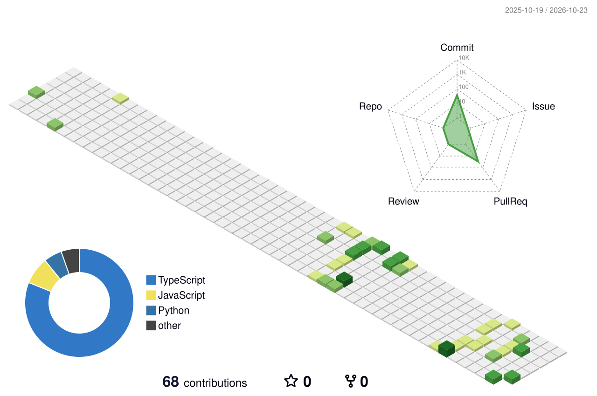

<div align="center">

<!-- BANNER ANIMADO -->


<!-- TEXTO ANIMADO -->
[](https://git.io/typing-svg)

<br/>


</div>


##  Sobre mí

```yaml
nombre      : Santiago Ribecca
ubicación   : 🇦🇷 Buenos Aires, Argentina
estudios    : Ingeniería en Informática @ UADE (4.º año)
intereses   : [ Backend, Arquitectura de software, Análisis de datos, Emulación ]
idiomas     : [ Español (nativo), Inglés (avanzado) ]
setup       : Arch Linux + Omarchy 🐧
```


##  Tecnologías

<div align="center">

| # | Categoría | Íconos |
|---|---|---|
| 🔤 | **Lenguajes** | [](#) |
| ⚙️ | **Backend** | [](#) |
| 🎨 | **Frontend** | [](#) |
| 🗄️ | **Bases de datos** | [](#) |
| 🚀 | **DevOps y herramientas** | [](#) |

</div>


##  Proyectos

| Proyecto | Qué es | Stack |
|---|---|---|
| 🎮 **Emulador de NES** | Emulación ciclo a ciclo del CPU 6502 validada contra nestest, PPU, APU y 5 mappers (~85% del catálogo), con save states y debugger | Go · SDL2 |
| ⚡ **Ecopedia** | Plataforma de reserva y tarificación de estaciones de carga para autos eléctricos, en servicios con JWT compartido, mensajería JMS y SOAP | Java 21 · Spring Boot · ActiveMQ · PostgreSQL · React 19 |
| 🧱 **Brick-o-meter** | ¿Una deuda UVA acompaña el precio del m²? Scraping, clustering con k-means y simulación Monte Carlo con backtesting | Python · pandas · scikit-learn · Streamlit |
| 🔨 **Subaspedia** | App de subastas en tiempo real, serverless y con tipado de extremo a extremo | React Native · Hono · Cloudflare Workers · Durable Objects |
| 🎟️ **Passpedia** | Marketplace de entradas con API REST por capas y autorización por roles | Java 21 · Spring Security · MySQL · React · Redux |


##  Estadísticas

<div align="center">


</div>


##  Contribuciones en 3D

<div align="center">

<picture>
  <source media="(prefers-color-scheme: dark)" srcset="./profile-3d-contrib/profile-night-rainbow.svg" />
  
</picture>

</div>


##  Contacto

<div align="center">

[](https://www.linkedin.com/in/santiago-ribecca)
[](mailto:ribeccasantiago@gmail.com)

</div>

<div align="center">

<!-- OLA DEL PIE (mismos colores que el banner) -->


</div>
